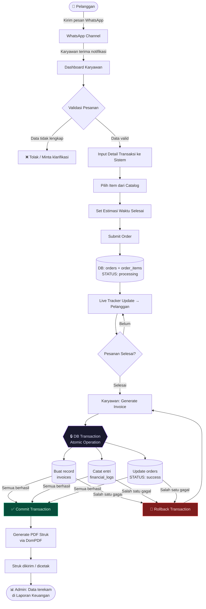
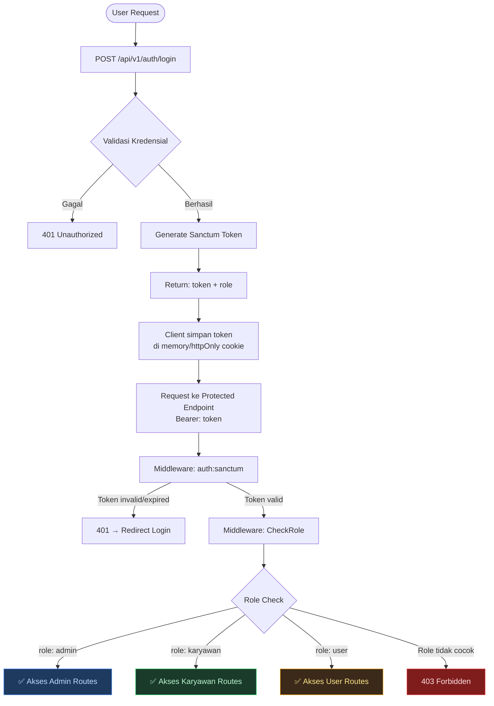
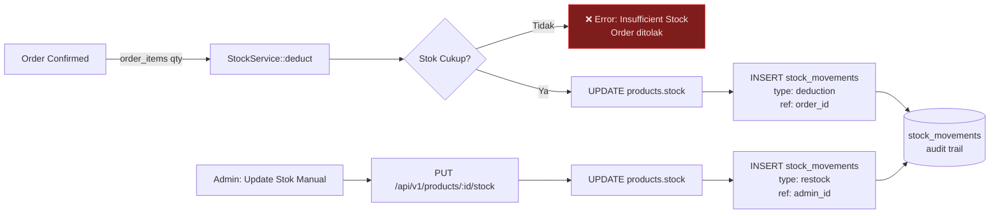
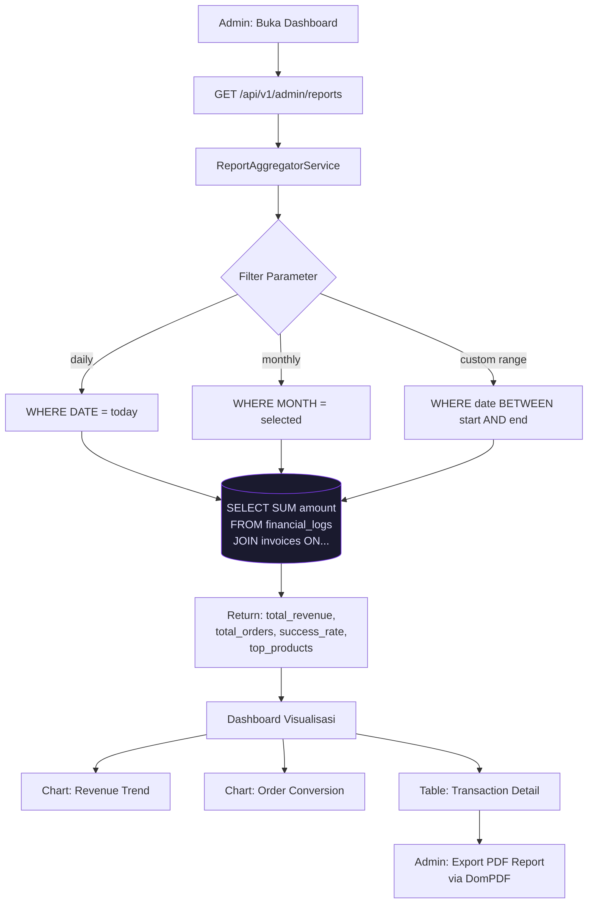
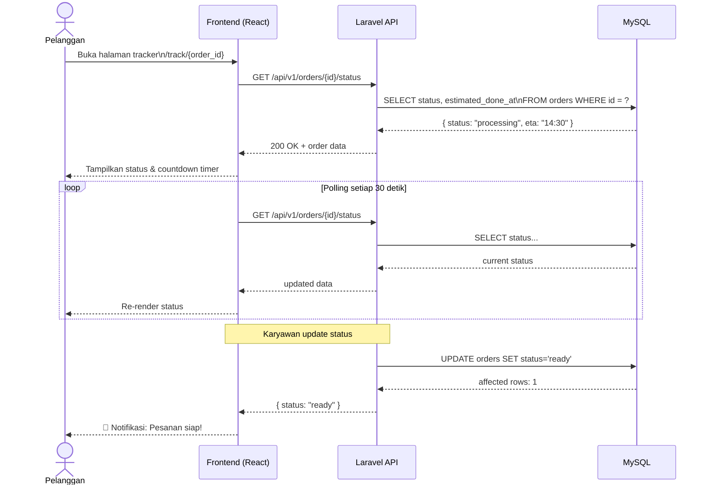
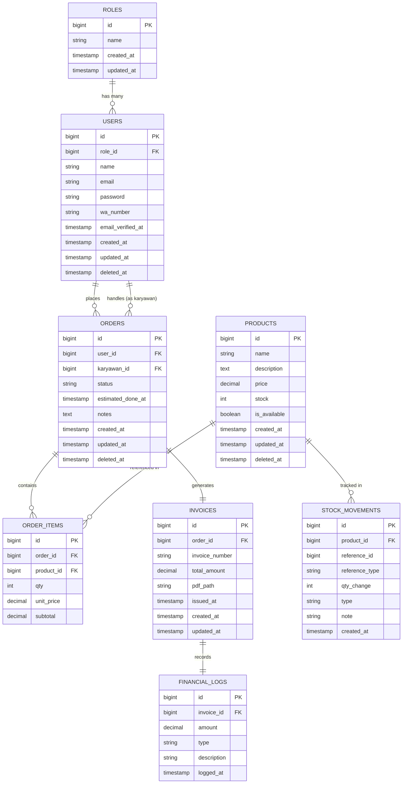

# 🧊 Es Gieta Smart-Ops V2

<div align="center">


**Sistem Manajemen Operasional F&B Terintegrasi**
*Role-Based Access Control · Automated Financial Reporting · Digital Receipt*

</div>

---

## 📋 Daftar Isi

- [Deskripsi Proyek](#-deskripsi-proyek)
- [Arsitektur Sistem](#️-arsitektur-sistem)
- [Diagram Alur Data](#-diagram-alur-data)
- [Skema Database](#️-skema-database)
- [Manajemen Hak Akses (RBAC)](#-manajemen-hak-akses-rbac)
- [Tech Stack](#️-tech-stack)
- [Struktur Direktori](#-struktur-direktori)
- [Instalasi & Setup](#-instalasi--setup)
- [Dokumentasi API](#-dokumentasi-api)
- [Roadmap Pengembangan](#-roadmap-pengembangan)
- [Lisensi](#️-lisensi)

---

## 📌 Deskripsi Proyek

**Es Gieta Smart-Ops V2** adalah platform manajemen operasional internal untuk bisnis F&B yang mengintegrasikan alur kerja antara Admin, Karyawan, dan Pelanggan dalam satu ekosistem terpusat. Sistem dirancang dengan prinsip **data integrity first** — setiap transaksi yang terkonfirmasi secara atomik memperbarui status pesanan, menerbitkan invoice digital, dan mencatat entri keuangan dalam satu operasi database yang tidak dapat diinterupsi.

**Problem yang diselesaikan:**
- Eliminasi pencatatan keuangan manual yang rawan human-error
- Sentralisasi pemantauan pesanan dari channel WhatsApp
- Transparansi laporan finansial real-time untuk pengambilan keputusan bisnis
- Audit trail lengkap untuk setiap pergerakan stok dan transaksi

---

## 🏗️ Arsitektur Sistem

```
┌─────────────────────────────────────────────────────────────┐
│                    CLIENT LAYER                              │
│  ┌──────────────┐  ┌──────────────┐  ┌──────────────────┐  │
│  │  Admin SPA   │  │ Karyawan SPA │  │   User Page      │  │
│  │  (React+Vite)│  │ (React+Vite) │  │  (React+Vite)    │  │
│  └──────┬───────┘  └──────┬───────┘  └────────┬─────────┘  │
└─────────┼─────────────────┼───────────────────┼─────────────┘
          │                 │                   │
          ▼                 ▼                   ▼
┌─────────────────────────────────────────────────────────────┐
│                    API GATEWAY LAYER                         │
│              Laravel Sanctum (Token Auth)                    │
│              Rate Limiting · CORS · Middleware               │
│              Route Prefix: /api/v1/                          │
└─────────────────────────┬───────────────────────────────────┘
                          │
          ┌───────────────┼───────────────┐
          ▼               ▼               ▼
┌──────────────┐ ┌──────────────┐ ┌──────────────┐
│ Admin Routes │ │  Staff Routes│ │  User Routes │
│  /dashboard  │ │  /orders     │ │  /catalog    │
│  /reports    │ │  /invoices   │ │  /tracker    │
│  /products   │ │  /products   │ │  /wa-order   │
└──────┬───────┘ └──────┬───────┘ └──────┬───────┘
       │                │                │
       ▼                ▼                ▼
┌─────────────────────────────────────────────────────────────┐
│                   SERVICE / BUSINESS LOGIC                   │
│   OrderService · InvoiceService · FinancialLogService        │
│   StockService · ReportAggregatorService                     │
└─────────────────────────┬───────────────────────────────────┘
                          │
┌─────────────────────────▼───────────────────────────────────┐
│                    DATABASE LAYER                            │
│                    MySQL 8.0                                 │
│   users · roles · products · orders · order_items           │
│   invoices · financial_logs · stock_movements               │
└─────────────────────────────────────────────────────────────┘
```

---

## 📊 Diagram Alur Data

### 1. Alur Utama: Order → Invoice → Financial Log



---

### 2. Alur Autentikasi & RBAC



---

### 3. Alur Manajemen Stok



---

### 4. Alur Agregasi Laporan Keuangan (Admin)



---

### 5. Alur Live Tracker (Perspektif Pelanggan)



---

## 🗄️ Skema Database

### Entity Relationship Overview



### Detail Kolom Penting

#### Tabel `orders` — kolom `status`
| Value | Deskripsi |
|---|---|
| `pending` | Pesanan masuk dari WhatsApp, belum divalidasi karyawan |
| `processing` | Karyawan konfirmasi, sedang diproses |
| `ready` | Pesanan selesai dibuat, siap diambil |
| `success` | Invoice diterbitkan, transaksi selesai |
| `cancelled` | Pesanan dibatalkan |

#### Tabel `financial_logs` — kolom `type`
| Value | Deskripsi |
|---|---|
| `credit` | Pemasukan dari penjualan |
| `debit` | Pengeluaran (refund, dll) |

#### Tabel `stock_movements` — kolom `type`
| Value | Deskripsi |
|---|---|
| `deduction` | Stok berkurang karena order |
| `restock` | Stok bertambah karena input manual admin |
| `adjustment` | Koreksi manual |

---

## 👥 Manajemen Hak Akses (RBAC)

Implementasi menggunakan **Spatie Laravel-Permission** dengan middleware per-route.

```
┌─────────────────────────────────────────────────────────────┐
│ ROLE: admin                                                  │
├─────────────────────────────────────────────────────────────┤
│ ✅ GET  /api/v1/admin/dashboard   — Statistik agregat       │
│ ✅ GET  /api/v1/admin/reports     — Seluruh laporan keuangan│
│ ✅ POST /api/v1/products          — Tambah produk           │
│ ✅ PUT  /api/v1/products/:id      — Update harga & stok     │
│ ✅ DEL  /api/v1/products/:id      — Soft delete produk      │
│ ✅ GET  /api/v1/admin/orders      — Lihat semua pesanan      │
└─────────────────────────────────────────────────────────────┘

┌─────────────────────────────────────────────────────────────┐
│ ROLE: karyawan                                               │
├─────────────────────────────────────────────────────────────┤
│ ✅ GET  /api/v1/orders            — Pesanan masuk (own)     │
│ ✅ POST /api/v1/orders            — Input detail pesanan    │
│ ✅ PUT  /api/v1/orders/:id/status — Update status pesanan   │
│ ✅ POST /api/v1/invoices          — Generate invoice/struk  │
│ ✅ GET  /api/v1/products          — Lihat catalog & stok    │
│ ❌ Semua route /admin/*           — Diblokir 403            │
└─────────────────────────────────────────────────────────────┘

┌─────────────────────────────────────────────────────────────┐
│ ROLE: user (Pelanggan)                                       │
├─────────────────────────────────────────────────────────────┤
│ ✅ GET  /api/v1/catalog           — Lihat menu tersedia     │
│ ✅ GET  /api/v1/orders/:id/status — Live tracker pesanan    │
│ ✅ GET  /api/v1/orders/:id/wa     — Redirect ke WhatsApp    │
│ ❌ Semua route create/update/delete — Diblokir 403          │
└─────────────────────────────────────────────────────────────┘
```

---

## 🛠️ Tech Stack

| Layer | Teknologi | Versi | Keterangan |
|---|---|---|---|
| **Frontend** | React JS + Vite | 18.x / 5.x | SPA dengan code-splitting per role |
| **Styling** | Tailwind CSS | 3.x | Utility-first, JIT compiler |
| **Backend** | Laravel | 11.x | REST API, Service Layer pattern |
| **Auth** | Laravel Sanctum | built-in | Token-based auth untuk SPA |
| **RBAC** | Spatie Laravel-Permission | 6.x | DB-driven roles & permissions |
| **Database** | MySQL | 8.0+ | Relational, ACID-compliant |
| **PDF** | barryvdh/laravel-dompdf | 3.x | HTML template → PDF invoice |
| **ORM** | Eloquent | built-in | Dengan SoftDeletes & Transactions |

---

## 📁 Struktur Direktori

```
es-gieta-smart-ops/
│
├── backend/                          # Laravel 11
│   ├── app/
│   │   ├── Http/
│   │   │   ├── Controllers/
│   │   │   │   ├── Admin/
│   │   │   │   │   ├── DashboardController.php
│   │   │   │   │   ├── ReportController.php
│   │   │   │   │   └── ProductController.php
│   │   │   │   ├── Staff/
│   │   │   │   │   ├── OrderController.php
│   │   │   │   │   └── InvoiceController.php
│   │   │   │   └── User/
│   │   │   │       ├── CatalogController.php
│   │   │   │       └── TrackerController.php
│   │   │   └── Middleware/
│   │   │       └── CheckRole.php
│   │   ├── Models/
│   │   │   ├── User.php
│   │   │   ├── Product.php
│   │   │   ├── Order.php
│   │   │   ├── OrderItem.php
│   │   │   ├── Invoice.php
│   │   │   ├── FinancialLog.php
│   │   │   └── StockMovement.php
│   │   └── Services/
│   │       ├── OrderService.php
│   │       ├── InvoiceService.php        # Atomic transaction logic
│   │       ├── FinancialLogService.php
│   │       ├── StockService.php
│   │       └── ReportAggregatorService.php
│   ├── database/
│   │   ├── migrations/
│   │   └── seeders/
│   │       ├── RoleSeeder.php
│   │       └── ProductSeeder.php
│   └── routes/
│       └── api.php                       # Versioned: /api/v1/
│
└── frontend/                         # React 18 + Vite
    ├── src/
    │   ├── pages/
    │   │   ├── admin/
    │   │   │   ├── Dashboard.jsx
    │   │   │   ├── Reports.jsx
    │   │   │   └── Products.jsx
    │   │   ├── staff/
    │   │   │   ├── Orders.jsx
    │   │   │   └── InvoiceGenerator.jsx
    │   │   └── user/
    │   │       ├── Catalog.jsx
    │   │       └── Tracker.jsx
    │   ├── components/
    │   ├── services/                     # Axios API calls per module
    │   └── hooks/
│
└── README.md
```

---

## 🚀 Instalasi & Setup

### Prerequisites

```
- PHP >= 8.2
- Composer >= 2.x
- Node.js >= 20.x + npm
- MySQL 8.0+
```

### Backend (Laravel)

```bash
# 1. Clone repository
git clone <repo-url> && cd es-gieta-smart-ops/backend

# 2. Install dependencies
composer install

# 3. Environment setup
cp .env.example .env
php artisan key:generate

# 4. Konfigurasi .env
DB_CONNECTION=mysql
DB_HOST=127.0.0.1
DB_PORT=3306
DB_DATABASE=esgieta_db
DB_USERNAME=root
DB_PASSWORD=your_password

# 5. Migrasi & Seeder
php artisan migrate
php artisan db:seed --class=RoleSeeder

# 6. Jalankan server
php artisan serve
```

### Frontend (React + Vite)

```bash
cd es-gieta-smart-ops/frontend

# Install dependencies
npm install

# Konfigurasi API base URL
# Edit src/services/api.js → baseURL: 'http://localhost:8000/api/v1'

# Jalankan dev server
npm run dev
```

---

## 📡 Dokumentasi API

### Authentication

| Method | Endpoint | Deskripsi | Auth |
|---|---|---|---|
| `POST` | `/api/v1/auth/login` | Login, return Sanctum token | ❌ |
| `POST` | `/api/v1/auth/logout` | Revoke token | ✅ |
| `GET` | `/api/v1/auth/me` | Data user aktif | ✅ |

### Admin

| Method | Endpoint | Deskripsi | Role |
|---|---|---|---|
| `GET` | `/api/v1/admin/dashboard` | Statistik agregat | admin |
| `GET` | `/api/v1/admin/reports` | Laporan keuangan + filter | admin |
| `GET` | `/api/v1/admin/reports/export` | Export PDF laporan | admin |
| `GET` | `/api/v1/products` | List produk + stok | admin |
| `POST` | `/api/v1/products` | Tambah produk | admin |
| `PUT` | `/api/v1/products/{id}` | Update produk | admin |
| `DELETE` | `/api/v1/products/{id}` | Soft delete produk | admin |

### Karyawan

| Method | Endpoint | Deskripsi | Role |
|---|---|---|---|
| `GET` | `/api/v1/orders` | List pesanan masuk | karyawan |
| `POST` | `/api/v1/orders` | Input pesanan baru | karyawan |
| `PUT` | `/api/v1/orders/{id}/status` | Update status + ETA | karyawan |
| `POST` | `/api/v1/invoices` | Generate invoice (atomic) | karyawan |
| `GET` | `/api/v1/invoices/{id}/download` | Download PDF struk | karyawan |

### User (Pelanggan)

| Method | Endpoint | Deskripsi | Role |
|---|---|---|---|
| `GET` | `/api/v1/catalog` | Menu tersedia | user |
| `GET` | `/api/v1/orders/{id}/status` | Live tracker status | user |
| `GET` | `/api/v1/orders/{id}/wa` | Redirect WhatsApp order | user |

---

## 📅 Roadmap Pengembangan

> Urutan berdasarkan dependency chain — setiap fase adalah prerequisite fase berikutnya.

```
FASE 1 — FOUNDATION
├── [x] Inisialisasi project Laravel 11 + React Vite
├── [ ] Setup MySQL & konfigurasi .env
├── [ ] Perancangan & eksekusi migrasi database
│         users, roles, products, orders, order_items,
│         invoices, financial_logs, stock_movements
└── [ ] RoleSeeder (admin, karyawan, user)

FASE 2 — AUTENTIKASI & RBAC
├── [ ] Install & konfigurasi Laravel Sanctum
├── [ ] Install & konfigurasi Spatie Laravel-Permission
├── [ ] AuthController (login, logout, me)
├── [ ] Middleware CheckRole per route group
└── [ ] Testing: isolasi akses antar role

FASE 3 — CORE BUSINESS LOGIC
├── [ ] CRUD Products (Admin) + StockService
├── [ ] OrderController + OrderService (Karyawan)
├── [ ] Validasi stok saat order dibuat
└── [ ] Status update pipeline (pending → processing → ready)

FASE 4 — INVOICE & KEUANGAN (KRITIKAL)
├── [ ] InvoiceService dengan DB::transaction atomic
│         Buat invoice + catat financial_log + update order
├── [ ] Install DomPDF (barryvdh/laravel-dompdf)
├── [ ] Template HTML untuk struk digital
└── [ ] Endpoint download PDF invoice

FASE 5 — DASHBOARD & REPORTING (ADMIN)
├── [ ] ReportAggregatorService (daily/monthly/custom)
├── [ ] Dashboard API: total pesanan, konversi, revenue
├── [ ] Export PDF laporan keuangan
└── [ ] Visualisasi chart di frontend (React)

FASE 6 — USER INTERFACE
├── [ ] Frontend: Auth pages + token management
├── [ ] Frontend: Admin dashboard + laporan
├── [ ] Frontend: Karyawan order management + invoice generator
├── [ ] Frontend: User catalog + WhatsApp redirect
└── [ ] Frontend: Live Tracker dengan polling 30 detik

FASE 7 — HARDENING & DEPLOYMENT
├── [ ] Rate limiting pada semua endpoint publik
├── [ ] Soft deletes verification (products, orders)
├── [ ] Environment separation (APP_DEBUG=false production)
├── [ ] Database backup strategy (mysqldump cron)
└── [ ] Final QA: RBAC audit, financial data integrity test
```

---

## ⚙️ Keputusan Teknis & Rationale

| Keputusan | Pilihan | Alternatif | Alasan |
|---|---|---|---|
| Auth mechanism | Laravel Sanctum | Passport (OAuth2) | Sanctum cukup untuk SPA internal; Passport overkill |
| RBAC | Spatie Permission | Gate & Policies | DB-driven, scalable tanpa deploy ulang |
| PDF | DomPDF | Browsershot | DomPDF zero dependency eksternal; Browsershot butuh Node.js di server |
| Polling vs WebSocket | HTTP Polling (30s) | Laravel Echo + Pusher | Cukup untuk use case tracker; WebSocket butuh infra tambahan |
| Soft Deletes | Aktif di semua tabel | Hard delete | Financial data tidak boleh dihapus permanen |
| Atomic Transaction | `DB::transaction()` | Manual rollback | Mencegah partial write pada financial_logs |

---

## 🛡️ Lisensi

```
Copyright © 2026 abuab. All Rights Reserved.

Sistem ini adalah perangkat lunak proprietary.
Dilarang keras mendistribusikan, memodifikasi, atau menggunakan
ulang kode ini tanpa izin tertulis dari pemilik.
```

---

<div align="center">
  <sub>Es Gieta Smart-Ops V2 · Built with Laravel 11 + React 18 · © 2026 abuab</sub>
</div>
